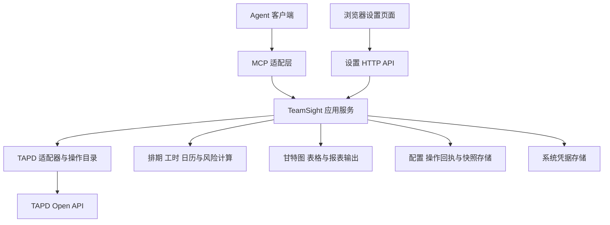

# TeamSight 本地服务 + MCP 技术方案（头脑风暴讨论稿）

## Summary

版本：v0.2；日期：2026-10-27；状态：已吸收用户对范围、产物和首发平台的澄清，技术选型仍为讨论稿，尚未确认实施。

目标是把 TeamSight 的核心能力从桌面应用中提取出来，成为运行在用户电脑上的团队数据服务。Agent 通过 MCP 搜索和操作 TAPD，并获取可信的排期、工时、报表与风险结果；浏览器承担设置，图表与报表作为 MCP 产物交付给 Agent。

TeamSight 负责身份解析、数据获取、业务计算、渲染和操作执行；Agent 负责理解自然语言、组合工具和解释结果。首版不要求 TeamSight 内置模型、聊天窗口或模型 API Key。

### 已明确的需求与技术建议

| 议题 | 当前结论 |
| --- | --- |
| 产品主形态 | 用户已明确：本地服务，提供 MCP 与浏览器设置页 |
| 能力目标 | 用户已明确：基础 TAPD 操作、复合取数、甘特图、工时表、报表、预警 |
| 首版优先级 | 用户已明确：优先排期、工时、风险及图表/报表，同时具备需求与任务的搜索、读取、创建、修改 |
| 前端范围 | 用户已明确：只需设置页；结果由 Agent 呈现，不建设独立结果查看模块 |
| 产物形态 | 用户已明确：可以是生成式 UI、图片、HTML；按 Agent 的实际呈现能力选择 |
| 预警执行方式 | 用户已明确：按需检查，由 Agent 调用时返回风险 |
| 使用范围 | 暂按单机、单个本地用户、多个 Agent 客户端设计；团队共享部署另行设计 |
| 旧桌面应用 | 建议过渡期保留用于对照；最终是否保留桌面壳尚未决定 |
| 目标 Agent | 用户已明确：Codex、Deepseek Harness；后者的具体版本、实现和 MCP 能力仍需适配验证 |
| 目标系统 | 用户已明确：优先 macOS 与 Windows，Linux 后续支持 |

### 产品形态的讨论

可选择三个方向：

1. **TAPD 工具箱**：把开放 API 提供给 Agent。容易理解，但复杂查询仍需要 Agent 反复取数、处理分页和业务口径。
2. **团队分析服务**：提供“获取团队排期”“分析每日工时”“检查风险”等复合能力。能直接复用 TeamSight 已有价值。
3. **后台执行助手**：在分析之外定时检查、生成周期报表和推送提醒。需要持久状态、调度与通知渠道。

本轮已收敛为以第二个方向为产品重心，同时具备第一种基础能力。第三种不是首版范围。这样既能满足“创建一个需求/任务”，也能直接回答“下周谁还有容量，以及依据是什么”。

### 典型使用流程

- 首次使用：启动本地服务 → 浏览器配置 TAPD 凭据、项目、成员、工时规则 → 连接 Agent。
- 查看团队：用户询问下周排期 → Agent 调用复合查询 → 服务返回结构化结果与甘特图图片/HTML → Agent 在其支持的会话界面呈现并解释。
- 操作 TAPD：用户要求在指定需求下创建任务 → Agent 获取需求与项目字段 → 服务校验并执行 → 返回任务 ID、链接与操作回执。
- 生成报表：服务在固定快照和规则下计算事实，生成 Markdown/HTML；Agent 可据此补充解释与建议。

## Implementation Plan

### 1. 现有实现与复用边界

本节来自当前工作区源码阅读，不代表本轮重新执行过测试。

| 现有能力 | 当前入口 | 新形态的处理 |
| --- | --- | --- |
| TAPD 传输 | [client.ts](/Users/haolin/Projects/team-sight/src/services/tapd/client.ts:45)、[Rust 代理](/Users/haolin/Projects/team-sight/src-tauri/src/lib.rs:157) | 现有传输仅 GET，默认依赖 Tauri；新增服务端传输，保留聚合与映射逻辑 |
| 排期聚合 | [fetchScheduleTasks](/Users/haolin/Projects/team-sight/src/services/tapd/client.ts:239) | 抽成服务能力，继续保留分页、部分失败和截断提示 |
| 工时取数 | [fetchHoursSnapshot](/Users/haolin/Projects/team-sight/src/services/tapd/hours.ts:63) | 复用算法与注入式传输；服务统一调度请求 |
| 工时计算 | [calculateHours](/Users/haolin/Projects/team-sight/src/hours/statistics.ts:23) | 抽成不依赖 Vue、DOM、Tauri 的核心模块 |
| 工时/请假规则 | [settings.ts](/Users/haolin/Projects/team-sight/src/hours/settings.ts:37) | 保留按小时扣减目标的行为，不退回整日豁免模型 |
| 中国工作日历 | [chinaCalendar.ts](/Users/haolin/Projects/team-sight/src/calendar/chinaCalendar.ts:49) | 保留共同规则与年度缓存语义，下载和持久化迁至服务 |
| 甘特图布局 | [layout.ts](/Users/haolin/Projects/team-sight/src/gantt/layout.ts:122) | 复用单一布局计算，新增静态 SVG 输出 |
| 甘特图交互 | [GanttBoard.vue](/Users/haolin/Projects/team-sight/src/components/gantt/GanttBoard.vue:1) | HTML 产物或宿主内 UI 按需复用组件；DOM 滚动和悬浮逻辑不进入服务计算层 |
| 设置页面 | [SettingsPage.vue](/Users/haolin/Projects/team-sight/src/pages/SettingsPage.vue:1) | 复用表单和交互，持久化改为服务 API |
| 设置持久化 | [settings.ts](/Users/haolin/Projects/team-sight/src/services/settings.ts:22) | 现有 Tauri JSON 与浏览器开发 localStorage 改为服务端统一存储 |
| 凭据 | [credentials.ts](/Users/haolin/Projects/team-sight/src/services/credentials.ts:42) | 浏览器只提交和管理凭据状态，不再沿用开发用 localStorage 存令牌 |

目前有两条值得主动统一的边界：看板与工时的取数覆盖不同；看板“今天”取宿主本地日期，工时采用北京时间。新服务必须显式传入分析日与时区，避免部署环境改变结果。

当前任务/缺陷统计模型不包含需求。需求首先接入基础搜索、详情和操作能力；是否把需求作为甘特图父层另行讨论，不能直接把需求工时和子任务工时重复相加。

### 2. 技术选型

建议采用 **TypeScript + Node.js 本地服务、Vue 设置页面、官方 MCP TypeScript SDK**。原有 Vue 图表组件可在 HTML 产物或支持的宿主内 UI 中复用。

| 选择 | 收益 | 代价 | 建议 |
| --- | --- | --- | --- |
| TypeScript 服务 | 复用现有计算、布局、映射和测试；前后端共享契约 | 需要 Node 运行时和发布打包设计 | 推荐 |
| Rust 服务 | 原生分发便利，沿用现有 Rust 技术 | 关键业务目前在 TypeScript，需重写或维护跨语言调用 | 暂不采用 |
| Rust 容器 + TypeScript 子进程 | 可以保留桌面启动体验 | 多进程生命周期与打包增加复杂度 | 后续确有桌面壳需求时再评估 |

HTTP 层建议 Fastify；数据契约使用一份可生成 JSON Schema 的定义，同时服务 HTTP 与 MCP。Node 版本在实施时固定到受支持的 LTS，建议以 Node 24 为首发验证目标。MCP SDK、HTTP 框架及渲染依赖锁定具体版本，避免依赖不受控升级。

### 3. 逻辑架构



首版是一个本地服务进程和一套静态网页资源，不拆微服务。MCP 与 HTTP 是同一套应用服务的入口，不各自维护取数、统计、权限或缓存实现。

建议使用 pnpm workspace，按四个边界逐步提取：

- `packages/core`：领域类型、映射、日期/日历、排期布局、工时计算、风险规则；不依赖宿主环境。
- `packages/tapd`：操作目录、字段元数据、服务端 HTTP、分页、请求队列和 TAPD 错误转换。
- `apps/server`：本地服务生命周期、HTTP/MCP 适配器、配置、存储、鉴权、分析与输出用例。
- `apps/web`：Vue 设置页；图表 HTML 作为独立产物资源构建，不增加结果管理页面。

不一次性搬迁所有组件。先提取核心函数、保留旧入口的转导出，让既有应用和测试继续引用同一份实现。浏览器交互状态与服务端事实结果保持分离。

### 4. 基础 TAPD 能力：常用工具 + 可发现的操作目录

“任何基础 TAPD 操作”的边界应定义为：**TAPD Open API 实际支持、当前凭据有权限、且 TeamSight 已登记支持的操作**。网页按钮不等于存在对应开放接口；首版也不能仅凭一个通用 HTTP 工具宣称完整覆盖。

建议维护显式操作目录，每项记录：操作 ID、文档来源、读写类别、固定方法/路径、请求编码、字段 Schema、工作区要求、分页方式、返回解析方式及支持状态。

| MCP 工具组 | 建议工具 | 用途 |
| --- | --- | --- |
| 常用入口 | `tapd_search_items`、`tapd_get_item`、`tapd_create_item`、`tapd_update_item` | 按 `entityType=story/task` 为需求与任务提供搜索、读取、创建、修改；参数按对象类型分别校验 |
| 项目元数据 | `tapd_list_workspaces`、`tapd_get_workspace_schema` | 获取项目、成员、字段、候选值和工作流信息，减少参数猜测 |
| 广泛 API 覆盖 | `tapd_list_operations`、`tapd_describe_operation`、`tapd_call_operation` | 按需发现和调用已登记的接口，避免所有接口都变成常驻工具 |

常用工具只是操作目录的便利入口，必须走相同的鉴权、校验、执行和审计链。通用调用不能绕过写入策略。

首版明确交付需求和任务的搜索/详情/创建/更新、项目与成员，以及统计所需的任务、缺陷和工时查询。其余对象逐批登记，给出“已支持/仅文档核对/尚未实现/凭据无权限”的覆盖清单。

重要契约：

- TAPD ID 全程使用字符串，避免长整型在 JavaScript 中损失精度。
- 项目和成员名称可用于查找；解析到多个结果时返回候选，不猜测要写入的对象。
- 项目自定义字段、状态和优先级从元数据解析，不依赖固定中文名称或一组全局枚举。
- TAPD 的 HTTP 状态和响应体业务状态分别保留，不继续把两者混为同一个 `status`。
- 每个操作按实际文档定义编码和响应包装；例如创建与更新任务都使用 POST，不能机械套用 REST 动词。
- 服务固定 TAPD API 来源，不接受任意 URL、任意 Authorization 头或未登记的路径。

官方需求与任务的创建/更新文档已调研，但具体字段契约和现有 personal token 的写权限仍需在实施时验证；不得把现有 GET 成功视为写入权限证明。

### 5. 复合能力：让 Agent 调业务问题，而非拼接口

建议先提供以下少量复合工具，具体名称可在接口设计时调整：

| 工具 | 服务负责 | 返回内容 |
| --- | --- | --- |
| `teamsight_get_schedule` | 多项目取数、身份解析、筛选、覆盖声明 | 工作项、分组与排期视图模型、快照 ID |
| `teamsight_analyze_hours` | 每日实际与累计花费分开读取，按共同日历和请假规则计算 | 成员 × 日期数据、贡献明细、待安排量和未知原因 |
| `teamsight_render_gantt` | 基于指定快照生成布局与产物 | 图表元信息、PNG/SVG/HTML 与 MCP 资源引用 |
| `teamsight_generate_report` | 从同一分析结果生成事实指标和模板报表 | Markdown/HTML、数据依据和产物 ID |
| `teamsight_check_risks` | 按明确规则评估已有数据 | 风险类型、对象、证据、规则版本和不确定项 |

数据查询与渲染允许单独调用，也提供默认组合路径，避免“生成甘特图”必须由 Agent 手动编排大量内部步骤。

**分析上下文必须显式化**：项目、成员、展示区间、分析日、时区、规则版本、配置修订号和刷新策略。配置项目是默认业务范围，客户端被授予的工作区是授权范围，两者不能混为一谈。

同一次分析生成的表格、甘特图、报表与预警引用同一 `snapshotId` 和规则快照。变更规则后的重算生成新的分析结果 ID，保留其输入关系，避免“同一张图和表使用不同口径”。

返回值至少区分：

- 数据状态：`complete / partial / failed`，以及每个来源的覆盖范围。
- 新鲜程度：来源实际获取时间、缓存命中和是否过期，不用本次调用时间冒充数据时间。
- 计算条件：`asOfDate`、`timeZone`、工时单位、配置/日历/算法版本。
- 结果规模：行数、游标、截断原因和产物引用，避免把上万条完整记录塞进对话上下文。

数据不完整时继续保留已知事实，但不能把缺数视为零。查询失败、分页触顶、身份不明、工时单位未确定、日历缺失均返回结构化原因。

### 6. 甘特图、工时表与报表如何交付

**结构化数据是基础，图片、HTML 和生成式 UI 使用同一分析结果。**

| 输出 | 首版建议 | 使用方式 |
| --- | --- | --- |
| 排期 | JSON + PNG；SVG/HTML 可选 | Agent 读取数据，会话展示图片；支持时渲染 HTML 或生成 UI |
| 工时表 | JSON + 小范围 Markdown + CSV；支持 PNG/HTML 输出 | 对话看摘要或表格图片，文件承载完整成员日期矩阵 |
| 报表 | Markdown + HTML + 指标 JSON；按需生成图片摘要 | 可追溯事实表、工时汇总、当前排期和风险清单 |
| 风险 | JSON + 简短文字 | Agent 可继续追问依据与相关工作项 |

首版不必同时做 PDF、XLSX 与复杂模板编辑器。它们可在输出需求明确后增加。

甘特图服务端复用 `computeLayout` 新增 SVG 序列化器，不依赖启动完整浏览器截图。PNG 由 SVG 栅格化获得，作为首版必备输出；字体、长标题、多人分组、大画布拆分和各系统依赖需要独立验证。HTML 产物可复用现有 Vue 组件和相同布局规则；工时表图片从已算好的行列结果生成，不重复执行统计逻辑。

报表中的事实由程序生成，Agent 负责可选的解释文字。首版报告应称为“区间工时及当前排期报告”；没有变更历史或期间快照时，不承诺还原历史排期，也不把当前完成状态当成本周完成量。

三种呈现路径需要分开定义：

1. **服务渲染**：服务使用固定、可验证的模板生成 PNG/SVG/HTML，Agent 负责展示。默认返回摘要、JSON 和有尺寸预算的 PNG；大型结果拆图或改为产物引用。
2. **Agent 生成式 UI**：服务返回数据 Schema、分析结果、图表视图模型和口径说明；Agent 使用自己的 UI/产物能力组织呈现。服务不需要再运行一个模型，但关键数字仍来自服务结果。
3. **宿主内交互 UI**：目标宿主支持 MCP Apps 或相应 HTML 扩展时，增加 UI 资源适配。该能力不是“把 HTML 字符串放进普通 MCP 文本”就能实现。

工具可接受 `format=auto/json/png/svg/html` 等明确输出选项。`auto` 首先采用经过该客户端实测的展示配置，未知客户端使用 JSON/文本与 PNG 基线。不能从“支持 MCP”自动推断“支持执行 HTML”。

**客户端显示边界**：标准 MCP 能返回结构化内容、文本、图片和资源链接，但不保证宿主执行 HTML 或提供交互甘特图。OpenAI 官方文档确认 Codex 的 STDIO/Streamable HTTP 接入；已查阅的 UI 快速入门描述的是 ChatGPT 中的可选组件，不能据此认定 Codex 已有同样的 HTML 展示行为。Codex 和 Deepseek Harness 的实际会话展示均需独立验收。

产物返回 `artifactId`、`mimeType`、大小与 MCP `resourceUri`，按需附图片内容、文件名和本地下载地址；不要求 Agent 仅凭服务进程的绝对文件路径读取文件。HTML 可以作为自包含产物交付，不意味着增加一个 TeamSight 结果页面系统。

本地查看链接只保证本机浏览器可达。运行在云端或隔离容器、无法访问本机服务的 Agent 不属于默认兼容范围。MCP 资源读取可减少对宿主直接打开本地文件的依赖，但不会消除网络不可达问题。

### 7. 前端：Setting Page

复用现有设置交互，覆盖：

- TAPD 凭据配置、状态及连接诊断。
- 项目启用、显示名称和颜色；成员选择、工号和展示顺序。
- 每日规定工时、按小时请假、结束状态、中国节假日与调休。
- MCP 地址/启动方式、客户端配对与授权工作区、基础写入能力的启用。

保存统一进入服务，使用修订号处理并发修改。页面持有旧修订时返回冲突并要求重新载入或合并，防止两个标签页或 Agent 覆盖彼此配置。

日常查询、图表呈现和报表交互均由 Agent 承担。服务暴露产物生成与读取接口，产物自身携带数据时间、统计口径和完整性说明。

### 8. MCP 连接方式与服务生命周期

**主路径建议 Streamable HTTP**，因为它符合独立运行的本地服务模型，可让多个客户端访问同一份配置、缓存和分析结果。

**stdio 作为按需兼容路径**：若目标 Agent 只能启动子进程，则增加轻量 stdio 入口，转调同一个本地服务。它不能单独拥有另一套配置、缓存或写入队列。

Codex 可优先验证 Streamable HTTP 与独立 Bearer 凭据。Deepseek Harness 尚未获得具体实现/版本，先以标准工具调用契约适配；P0 验证其 HTTP、stdio、图片及资源支持后决定是否需要兼容入口。

命令形态示意，尚非现有可用命令：

```text
teamsight serve --open
teamsight status
teamsight doctor
teamsight stop
teamsight mcp --stdio   # 仅在目标客户端需要时增加
```

服务负责单实例、可发现的端口、健康检查、清晰的启动失败和优雅退出。端口被占用时提示诊断，不能结束未知进程。首版可要求手动启动；开机自启、托盘和自动启动服务后续增加。

协议实现使用官方 SDK，固定并验证“SDK 版本 + 协议版本 + 目标客户端”的组合。已查阅的 2026-07-28 规范与 2025-11-25 在初始化、状态和取消语义上存在变化；不能照搬旧版握手，也不能仅凭使用 SDK 就宣称支持所有版本。

短查询直接返回；耗时的多项目分析和大图输出提供普通工具形式的 `get_job / cancel_job`，不依赖某个宿主必然支持特定任务扩展。工作 ID、快照 ID、产物 ID 由参数显式传递，不把它们藏在 MCP 连接状态里。

### 9. 写入行为与结果不确定性

写入是本次目标的一部分，需要一条独立于只读重试的执行链。

- 连接按配置获得工作区与操作权限；普通创建/更新在已经授权的范围内执行，不强制每次再打开设置页确认。
- 删除、批量修改、权限变更等操作只有登记并实现相应策略后才开放。需要服务强制审批时，使用绑定具体操作与参数的待办记录，由设置页真实确认；Agent 自己提交的 `confirmed: true` 不构成用户批准。
- 创建/更新携带稳定幂等键。服务持久记录主体、操作、参数摘要、执行状态和远端对象 ID；同一键换参数应拒绝。
- 本地记录只能减少本服务内的重复执行，不能提供跨 TAPD 与本地存储的“恰好一次”保证。
- 请求已发出后超时、断连或服务重启，结果可能为 `unknown`；禁止沿用 GET 的自动重试而重复创建。应先通过回执、对象查询或用户核对进行确认。
- 对更新可使用读取时的 `modified`/字段摘要做前置检查；若 TAPD 不提供原子条件更新，只能降低冲突风险，不能承诺杜绝竞态。
- 写入后失效受影响的查询缓存。已封存报表保留原快照，不自动改写历史产物。
- 审计记录保留必要对象和结果，凭据与敏感正文不进入日志。

### 10. 本地访问与凭据

本地 HTTP 服务需要处理浏览器与 Agent 两类访问，不能把“只在本机监听”视为完整身份校验。

- 默认仅监听 loopback，验证 Host 与 Origin，拒绝任意来源跨域；远程部署不在首版范围。
- 浏览器通过本机启动时的一次性配对入口建立会话，使用 HttpOnly、SameSite 会话 Cookie，并校验修改请求的来源/CSRF；不把长期凭据放在 URL。
- MCP 使用独立的客户端访问凭据；与 TAPD 令牌分离，并在服务端校验其工作区和操作范围。MCP 会话标识或快照 ID 都不是授权依据。
- TAPD 凭据仅在服务端使用，优先系统凭据存储。设置页写入后只能读取配置状态和掩码，Agent 无法通过工具取回令牌。
- 无凭据管理器的环境需要明确的文件存储回退：Unix 权限与 Windows 用户访问控制分别实现并验证，不能假定 `0600` 在所有系统有效。
- TAPD 需求描述等外部内容作为数据返回；HTML 查看页做内容净化，不能将其当作指令或直接执行脚本。
- 产物按 ID 读取并鉴权，不接受任意磁盘路径；产物查看与下载不使用公网暴露的目录。
- HTML 产物不含服务访问凭据。通过 HTTP 提供可执行 HTML 时应用独立安全上下文，例如 CSP sandbox；避免产物脚本获得设置页同源权限。用户数据只作为转义后的数据进入受信模板。

### 11. 存储、缓存与并发

建议 SQLite 保存配置及修订、写入回执、分析/产物元信息；较大的图表和快照文件保存在服务数据目录。凭据单独进入系统凭据存储。只持久化当前功能所需数据，不建立完整 TAPD 镜像库。

- 配置和操作记录由服务统一写入，事务保护；导入/导出不包含原始令牌。
- 查询缓存延续现有“只缓存完整结果、保留原始获取时间”的原则。
- 缓存身份包含凭据主体/版本、授权范围、项目、成员、查询条件；显示名称等纯展示变化不应重新获取 TAPD 数据。
- 计算身份额外包含成员顺序、工时/请假规则、日历与分析日；规则变化可复用原始快照重算。
- 首版全服务共享 TAPD 请求队列，初始并发可沿用现有的 3，而非每个 Agent 各自再开 3 个请求。
- 安全读取按限流/临时故障做有上限的退避重试；写入是否可重试由具体操作与已知执行状态决定。
- 保留分页安全上限、重复分页检测、请求预算和取消；达到上限返回不完整状态，不静默截断。
- 现有工时取数存在“每个未结束工作项读取累计工时”的请求成本。迁为服务不会自动消除这个成本，应先量测，再依据 TAPD 已验证的过滤能力优化。
- 重启后未完成的计算任务标为中断；已发出的写入按不确定结果恢复，不直接重放。

保留分析输入、来源时间、规则版本和日历内容/摘要，确保已生成报表可解释。保存当前快照不等于拥有历史 TAPD 数据，历史重算范围必须明确说明。

### 12. 报表与预警的业务口径

首版报表建议包括区间已填报工时、每日目标及差额、当前预计排期、待安排剩余量和数据完整性。每个数字可回溯到日期、成员、工作项和工时记录。

预警分开讨论“如何判断”与“何时运行”：

| 规则 | 首版建议 | 前提 |
| --- | --- | --- |
| 历史已填报工时低于目标 | 可做 | 仅对已结束的统计日判定；考虑请假与日历，并保留完整性条件 |
| 未来预计排期不足 | 可做 | 复用现有工时模型，缺预估/身份/累计数据时返回未知 |
| 未结束工作项逾期 | 可做 | 按项目结束状态和分析日判断，并附任务依据 |
| 缺排期、缺预估 | 可做覆盖明确的提示 | 说明查询是否覆盖这些对象，不把未查到当作不存在 |
| 无负责人工作项 | 需补专项查询 | 现有按成员过滤的取数路径无法证明覆盖无负责人任务 |
| 容量超载、交付风险 | 后续扩展 | 需要可解释的需求量/容量模型，不能仅因任务时间重叠就判断超载 |

工时单位属于项目业务配置，不因 API 返回数字就假定所有项目都是小时。跨项目合计前需确认单位和转换规则。

当前日尚未结束时，低于每日目标可以是进度信息，不能直接等同于缺报。首次版本以已结束日为历史不足预警范围；是否增加截止时间由使用场景确认。

本轮已确定按需调用，首版不需要调度器、持续监控或外部通知。工具结果带检查时间和数据覆盖，Agent 可立即追问风险证据。若将来增加后台模式，再单独设计持久状态、去重、恢复和通知渠道。

### 13. 配置迁移与旧应用过渡

1. 以当前工作区实际行为作为基线，特别保留成员顺序、项目别名、按小时请假、节假日调休、部分数据提示与跨区间计算一致性。
2. 从旧应用配置目录导入当前 v3 配置，保留原始备份，新服务在事务中完成校验和迁移；不更改已有请假记录含义。
3. 旧凭据可在明确选择导入时转入新凭据存储；导入过程不把原值输出到页面或日志，不自动删除旧文件。
4. 旧应用与新服务过渡期不并发写同一个配置文件。新服务拥有自己的数据目录，通过导入确定起点。
5. 原应用用于结果对照；服务达到验收要求后，再决定退役桌面端或保留薄壳。长期只维护一套业务计算。

### 14. 分阶段交付及验收门槛

| 阶段 | 交付 | 通过条件 |
| --- | --- | --- |
| P0：架构与展示验证 | 核心模块无宿主依赖、最小服务、MCP 查询、设置读写、PNG/HTML 样本、存储与凭据依赖验证 | 不启动 Tauri 能取数和计算；Codex/Deepseek Harness 分别验证工具与产物；macOS/Windows 验证发布依赖 |
| P1：可用首版 | 设置页、基础操作目录、需求与任务搜索/读取/创建/修改、排期/工时复合工具、按需预警、图表和固定模板报告 | Agent 场景闭环；JSON/Markdown/PNG/CSV 可用，HTML 可生成且有明确宿主展示边界；业务口径与写入行为通过验收 |
| P2：适配与发布完善 | 两个 Agent 的呈现优化、可支持时的生成式 UI/MCP Apps、快照回溯、大图输出、安装与升级体验 | 图、表、报告一致；大数据量、字体、部分失败与跨平台使用可靠 |
| P3：后续扩展 | Linux、更多 TAPD 操作，以及经新需求确认的其他能力 | 对每项新增能力单独定义验证范围 |

以上是工作分解，未经原型验证不承诺固定工期。macOS 与 Windows 都是首发验收对象；Linux 不阻塞首版。

## Test Plan

本轮只进行需求分析、源码阅读和官方文档调研；以下为未来实施后的验证计划，尚未执行。

### 核心计算与迁移

- 把现有有效测试随核心模块迁移，补 Node 环境契约测试，确保核心不依赖 `window`、Vue、Tauri 或浏览器 Worker。
- 同一输入快照在现有计算和服务中得到一致的工时、日期、成员顺序与未知原因。
- 覆盖跨月、跨年、节假日、调休、部分小时请假、整日目标归零、多负责人及累计工时。
- 检查时区变化不会改变默认业务日，所有入口使用同一分析日；导入 v3 配置不丢失请假和日历缓存。

### TAPD 与写入

- 验证需求与任务搜索/详情/创建/修改、项目元数据、自定义字段的真实契约，保持 ID 字符串精度。
- 验证 HTTP 状态与 TAPD 业务错误、无权限、限流、分页截断及部分项目失败；不将失败显示为空结果。
- 在明确的测试项目中执行创建/更新验收，验证读回、回执、缓存失效、相同幂等键重放与参数冲突。
- 用可控故障模拟“远端成功、本地超时/退出”，确认返回未知并阻止盲重试；不声称实现远端恰好一次。
- 校验常用工具和通用目录调用权限一致，跨工作区、未授权写入与操作人字段无法绕过限制。

### MCP、HTTP 与生命周期

- 在 Codex 与用户实际使用版本的 Deepseek Harness 中分别验证工具发现、Schema、错误、结构化数据、图片/资源降级和服务断连恢复；记录 HTML 只是返回、可下载，还是确实能在会话执行呈现。
- 对实际使用的协议版本和 SDK 版本分别测试，尤其关注初始化/版本兼容与取消语义。
- 多客户端并发下只有一份配置与全局请求队列；配置修订冲突不丢更新。
- 验证绑定地址、Host/Origin、配对、CSRF、过期/撤销凭据、资源鉴权及日志脱敏。
- 验证端口冲突、优雅退出、重启后任务恢复状态及损坏配置/磁盘写入失败。

### 呈现与预警

- 对同一快照核对甘特图、工时表和报告，实际/预计/未知标识以及来源时间一致。
- 用多人长标题、跨窗口任务、无数据、部分失败和大范围数据检验 SVG/PNG/HTML/CSV；图像和文字转义不引入脚本或表格公式执行。
- 预警覆盖已结束日、当前未结束日、请假、数据不全和覆盖不足；无法确认时不输出确定风险结论或恢复结论。
- macOS 与 Windows 分别完成启动、凭据、存储、中文字体、渲染与发布包验证；Windows 还应覆盖路径空格、进程退出与用户文件权限。Linux 后续支持时再完成独立验收。

## Assumptions

- 本稿用于头脑风暴与技术收敛，不代表已确认功能取舍或已完成实现。
- 暂按本机用户使用、Agent 在本机可达、业务日界为 `Asia/Shanghai` 设计。远程 Agent 和团队共享服务器需要增加网络、身份及数据隔离设计。
- 先复用现有 task/bug 工时口径，不自动引入需求与任务重复汇总，也不把已填报工时解释为个人绩效。
- 已明确分析优先、需求/任务基础读写、仅设置页、按需预警，以及 Codex/Deepseek Harness 与 macOS/Windows 的首发范围。Deepseek Harness 的具体实现/版本、客户端展示能力和旧应用去留仍需在技术收敛或 P0 中明确。
- 本轮没有连接真实 TAPD 账号、创建或更新远端对象，也没有重新验证既有测试结论。

### 调研依据

- 当前项目源码及按需加载的 TAPD、甘特图、前端可靠性、中国日历与 Tauri 知识。
- [MCP Streamable HTTP：2026-07-28](https://modelcontextprotocol.io/specification/2026-07-28/basic/transports/streamable-http)：独立服务传输、安全边界及与较早版本的差异。
- [MCP 工具规范](https://modelcontextprotocol.io/specification/2026-07-28/server/tools)：工具 Schema、结构化内容、资源和显式状态引用。
- [官方 MCP SDK](https://modelcontextprotocol.io/docs/sdk)：实现语言与 SDK 入口，具体版本需实施时锁定。
- [MCP Apps](https://modelcontextprotocol.io/docs/extensions/apps)：支持宿主内交互 UI 的可选增强方式，不能假设所有客户端支持。
- [Codex MCP 官方文档](https://learn.chatgpt.com/docs/extend/mcp?surface=cli)：STDIO、Streamable HTTP 与认证配置；具体客户端仍需实测。
- [OpenAI MCP server and UI quickstart](https://developers.openai.com/plugins/build/app-quickstart)：工具接入与 ChatGPT 可选 UI 的区别，不能将其直接外推为 Codex HTML 支持。
- [TAPD API 目录](https://open.tapd.cn/document/api-doc/API%E6%96%87%E6%A1%A3/api_reference/)：需求、任务及其他开放对象的覆盖范围。
- [创建任务](https://open.tapd.cn/document/api-doc/API%E6%96%87%E6%A1%A3/api_reference/task/add_task.html)、[更新任务](https://open.tapd.cn/document/api-doc/API%E6%96%87%E6%A1%A3/api_reference/task/update_task.html)：请求方式、参数和返回对象。文档存在不代表当前凭据具有全部操作权限。
- [创建需求](https://open.tapd.cn/document/api-doc/API%E6%96%87%E6%A1%A3/api_reference/story/add_story.html)、[更新需求](https://open.tapd.cn/document/api-doc/API%E6%96%87%E6%A1%A3/api_reference/story/update_story.html)：基础需求写入能力的官方入口；实施时仍需核对项目级字段与真实权限。
