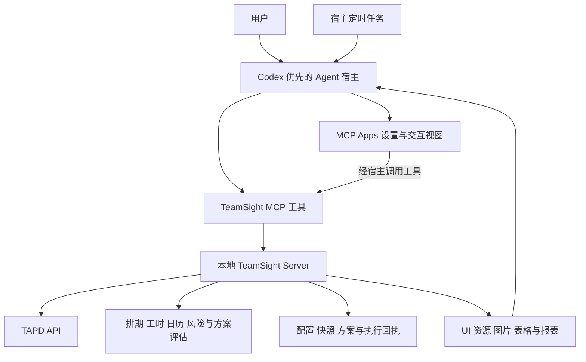

# TeamSight 头脑风暴讨论稿（第二轮）

## Summary

版本：v0.4；日期：2026-10-27；状态：产品取舍已确认，技术实现尚待方案确认与兼容性验证。

TeamSight 的新定位是：**运行在本机、通过 MCP 提供能力、通过 MCP Apps 承载交互的团队分析与排期协作服务。** 用户在 Agent 中提出问题、查看结果、调整方案；本地服务负责 TAPD 数据、业务计算、产物生成和操作执行。

本轮最重要的变化，是把“浏览器设置页”改为“会话内设置”，把“后台执行助手”改为“定时团队工作流”。用户已确认首版复用宿主定时任务；紧急需求插队作为后续使用场景，不纳入首版；旧 App 在过渡期保留对照，新形态达到验收后退役。其余取舍按本稿建议收敛，具体实现仍需兼容性验证。

### 1. 已明确的产品方向

| 议题 | 本轮结论 |
| --- | --- |
| 主体形态 | 本地 TeamSight Server，通过 MCP 被 Agent 调用 |
| 设置入口 | 以 MCP Apps 为目标，在会话内展示、编辑和提交配置；该路径成立后，无需独立浏览器设置页 |
| 结果入口 | 在会话内交付 MCP Apps、图表、表格、报表；不建设独立结果管理网站 |
| 分析能力 | 排期、每日工时、报表、按需风险检查是核心能力 |
| TAPD 基础能力 | 同时支持需求与任务的搜索、读取、创建、修改；其他开放接口逐步扩展 |
| 排期协作 | 紧急需求拆解、资源评估、方案比较与批量重排保留为后续使用场景，不纳入首版 |
| 定时执行 | 首版复用宿主定时任务，TeamSight 提供可重复执行的业务能力 |
| 旧 App | 过渡期保留对照，新形态达到验收后退役 |
| Agent 优先级 | Codex 优先，Deepseek Harness 次之；分别验证具体版本的能力 |
| 系统优先级 | macOS、Windows 优先，Linux 后续支持 |

### 2. 三个互补的产品方向

这三个方向在同一个服务内形成互补能力。

| 方向 | 用户得到什么 | 示例 |
| --- | --- | --- |
| TAPD 工具箱 | 用自然语言完成基础项目操作 | “找出这个迭代未完成的需求，并给需求 A 创建一个联调任务。” |
| 团队分析，后续扩展排期协作 | 首版分析事实，后续再增加方案比较与执行 | “下周排期与工时情况怎样？”；后续可问“紧急需求插进来会影响哪些承诺？” |
| 定时团队工作流 | 将重复的分析和跟进交给 Agent 定时执行 | “每个工作日下午检查昨日工时；每周五生成下周排期摘要。” |

建议以第二个方向作为 TeamSight 的产品重心，以第一个方向作为操作基础；第三个方向复用前两者的能力。自然语言理解与工具编排继续由宿主 Agent 承担。

### 3. 一次完整使用体验

1. 安装并注册 MCP，宿主启动连接时确保本地服务可用。
2. 用户首次使用 TeamSight，或说“打开 TeamSight 设置”，会话中出现 MCP Apps 配置界面。
3. 用户完成项目、成员、工时和连接配置，提交后由 MCP 工具写入本地服务。
4. 用户询问团队情况，Agent 获取可信的分析结果，并展示交互甘特图、工时表或报表。
5. 对重复需求，用户在宿主中建立定时任务，按时调用同一套 TeamSight 能力。
6. 后续扩展：出现紧急需求时，Agent 协助拆解，TeamSight 评估方案，用户比较影响后应用所选调整。

“首次使用展示配置”应理解为首次调用 TeamSight 时引导配置。MCP 服务不能保证在任意新对话开始时主动弹出界面；具体触发方式受宿主交互机制约束。

## Implementation Plan

以下内容说明能力划分与待验证条件。第 4、5 节保留后续场景设想，不作为首版编码清单；首版技术方案单独定义交付边界。

### 1. MCP Apps：会话内的设置与操作界面

**配置表单和图表作为 MCP UI 资源随服务交付，由宿主在会话内加载。** 这些界面仍需前端组件，可以复用现有 Vue 交互；方案比较界面随后续场景增加。



MCP Apps 的标准路径是：工具声明关联的 `ui://` 资源，宿主加载 HTML 并在受控界面中渲染，UI 通过宿主提供的通信桥调用工具。普通工具返回一段 HTML 文本，不等于完成 MCP Apps 接入。

#### 配置往返

建议提供“打开设置”“读取配置”“提交配置”“测试连接”等能力，工具名在接口设计阶段确定。

```text
首次调用 / 用户打开设置
  → 服务返回配置状态与设置 UI 资源
  → 宿主渲染 MCP Apps
  → UI 读取当前配置和修订号
  → 用户修改并提交
  → UI 经宿主调用 MCP 配置工具
  → 服务校验、持久化并返回新修订号
  → UI 展示保存结果，Agent 可继续业务操作
```

服务在没有 TAPD 凭据时也必须能启动并提供配置能力，避免“必须先完成连接才能打开连接配置”的循环。

| 配置区域 | 建议内容 |
| --- | --- |
| 连接 | TAPD 凭据状态、连接测试、可访问项目和权限诊断 |
| 团队 | 项目范围、别名、成员身份与顺序；技能和可承担工作类型留到后续场景 |
| 工时与日历 | 每日目标、按小时请假、中国节假日和调休、业务时区 |
| 操作范围 | 允许操作的项目与基础写入能力；批量调整策略留到后续场景 |
| 诊断 | 服务版本、连接状态、最近错误与脱敏诊断信息 |

本地服务是配置的唯一事实来源。多个对话中的设置卡片可能同时存在，保存要携带修订号；旧卡片不得覆盖较新的配置。iframe 状态只保存临时交互，不承担核心配置持久化。

凭据输入需要单独验证：配置界面不把令牌回显到对话、结果或日志，但 UI 调工具仍经过宿主，不能未经验证就承诺凭据不会进入宿主记录或模型上下文。P0 应验证敏感字段链路；必要时采用本机凭据注入或系统凭据管理入口，设置 UI 只呈现连接状态。该替代入口无需演变为独立设置网站。

#### Codex 是首要验证对象

已查阅的官方文档确认 Codex 支持 STDIO 和 Streamable HTTP 的 MCP 工具接入；MCP Apps 文档说明了交互 UI 协议。它们尚不足以证明当前目标 Codex 版本能完成本稿要求的 Apps 配置往返，OpenAI 的 ChatGPT UI 文档也不能直接代替 Codex 验证。

因此，**Codex 中加载设置 UI、提交配置并继续调用工具，是首个产品成立条件**。若验证存在缺口，需要重新讨论宿主适配或临时配置入口，不默认恢复独立浏览器设置页。Deepseek Harness 在 Codex 路径成立后再做同等验证，不假定两个宿主展示能力相同。

### 2. 产物：交互界面与可携带文件并存

MCP Apps 适合继续操作，图片和文件适合保存、分享及跨客户端使用。建议它们消费同一个分析结果，避免为每种展示重新计算一遍。

| 形态 | 适合的内容 | 建议定位 |
| --- | --- | --- |
| MCP Apps | 交互甘特图、工时筛选、报表展开；方案比较和应用后续增加 | 支持宿主中的主要交互形式 |
| 结构化 JSON | 指标、任务、风险证据、方案差异与执行回执 | Agent 理解、追问和编排的基础 |
| PNG / SVG | 甘特图、工时表、报表摘要 | 固定呈现、分享及展示兼容路径 |
| HTML | 可独立交付的交互报告或静态报告 | 可生成文件；会话内执行能力另行验证 |
| Markdown / CSV | 文本报告、完整工时数据与明细导出 | 易阅读、易复用的基础输出 |
| Agent 生成式 UI | 根据用户问题组织临时视图 | 使用服务返回的数据和口径，不另行编造指标 |

Apps 中的“换时间范围、看风险依据”通过 MCP 获取结果；UI 不直接访问 TAPD，也不自行维护另一套工时算法。后续的方案比较与应用沿用同一交互方式。

同一视图引用明确的快照、规则版本、分析日期和数据获取时间。风险、未知项、估算值、已执行变更在各类产物中保持一致。大图、大表按需加载或拆分，避免把完整数据一次塞进模型上下文。

这些视图属于一次查询或工作流的会话产物，不需要额外建设报表门户或结果列表网站。

### 3. 定时团队工作流：采用类似 Codex 定时任务的形式

已确认第一阶段使用 **宿主负责定时，TeamSight 负责执行** 的分工。

```text
用户定义任务内容与频率
  → 宿主创建定时任务并确认任务标识
  → 到点启动 Agent 执行
  → Agent 调用 TeamSight 查询、分析和渲染
  → 在宿主中交付结果或需要处理的事项
```

| 工作流 | 触发方式 | 结果 |
| --- | --- | --- |
| 每日工时检查 | 每个业务工作日的指定时间 | 昨日目标与实际差额、缺报线索、数据覆盖 |
| 每周排期回顾 | 每周五或自定义时间 | 下周排期、待安排工作、可能影响交付的事项 |
| 固定项目报告 | 按周或迭代节点 | 当前事实报表与相较上次快照的变化；有历史快照才做历史比较 |
| 紧急插队后跟进（后续场景） | 应用方案后的指定日期 | 原方案与当前进度差异、是否需要再次调整 |

定时工作流只是给“按需检查”增加触发入口，风险规则仍由服务统一维护；不需要另做一套持续监控引擎。

#### 两种实现方向的取舍

| 方向 | 收益 | 约束 | 本轮建议 |
| --- | --- | --- | --- |
| 宿主 Agent 调度 | 复用任务入口、对话、解释和通知体验 | 依赖宿主可用性、任务权限与本地 MCP 连接 | 优先 |
| TeamSight 自带调度器 | 可独立运行确定性查询和报告 | 需要额外处理作业恢复、分发和通知；不能自行唤醒关闭的 Agent | 后续出现明确独立运行需求时再讨论 |

TeamSight 可输出可复用的工作流参数与提示模板；只有宿主确实提供创建任务的能力并返回成功回执，才展示“定时任务已创建”。不能把服务保存了一份计划配置说成 Codex 已安排执行，也不能假设任意 MCP 服务都能直接管理宿主调度器。

首批定时工作流建议以读取、分析和生成结果为主。默认不要在无人值守时自动重排整个团队；如未来需要定时写入，应明确授权项目、对象、可变字段、允许影响范围和失败处理方式。

还需要验证以下实际条件：

- Codex 本地定时任务依赖电脑和应用运行；任务执行时必须能访问相同的 TeamSight 实例、配置和权限。
- “中国工作日”包含调休，不能简单等价为周一到周五；可按每日触发，再由业务日历决定是否执行。
- 明确时间、时区和补跑语义；电脑休眠或服务离线时，先按宿主真实行为呈现失败或缺次，不默认承诺自动补跑。
- 周期任务应有执行标识与回执；重试不得重复创建 TAPD 任务。无人值守时的工具权限和认证需要真实验证。

### 4. 后续场景：紧急需求插队

本节保留使用场景，不纳入首版交付，也不要求为此提前实现排期求解或技能配置。后续目标是让用户看见插队代价、比较可行方案，并将选定方案执行到 TAPD。

#### 场景示例

用户说：“这个需求希望周五交付，先拆一下任务，看看谁能接。如果影响现有排期，把需要调整的事项列出来，选定后直接调整。”

建议形成以下闭环：

1. **理解需求。** 读取 TAPD 需求与相关任务，识别范围、验收标准、截止日期和未明确问题。
2. **形成拆解草案。** Agent 提出任务、依赖、建议估时和可承担角色；标明已有事实与估算假设，避免把 AI 估时当作已确认承诺。
3. **获取资源事实。** 服务读取竞争任务、当前承诺、剩余工作、请假和工作日历；结合用户配置或明确提供的技能条件判断候选成员。
4. **评估多个方案。** 在统一快照上计算安排、容量、交付时间和受影响任务，返回可解释的约束与冲突。
5. **会话内比较。** MCP Apps 展示前后甘特图、任务分配、截止日期变化及未解决事项；用户可修改草案再计算。
6. **应用选定方案。** 在权限与已授权范围内，创建关联任务，修改相关负责人、日期或其他实际支持的字段。
7. **核对执行结果。** 重新读取 TAPD，报告已完成、失败与结果不确定的步骤，展示实际落地后的排期。

#### 先定义约束，再讨论“最优排期”

| 需要明确的信息 | 对方案的影响 |
| --- | --- |
| 紧急需求截止时间与可裁剪范围 | 决定期限是否硬约束、能否分阶段交付 |
| 任务估时与依赖 | 决定并行空间；仅有起止日期无法得出实际工作量 |
| 候选成员与技能条件 | 决定谁可以承担工作，不能仅根据历史工时推断能力 |
| 工作日历、每日容量和请假 | 决定实际可用时间，不默认通过加班填平缺口 |
| 固定承诺与可移动任务 | 决定哪些任务允许调整、哪些冲突必须明确报告 |
| 查询覆盖与未知项 | 数据不全时只能做带条件的方案，不能证明“没有其他工作” |

TAPD 之外的会议、支持工作等不会自动出现在排期中，可通过容量预留表达。多负责人如何分摊工作、剩余量如何估计，也应有明确口径。

#### 建议先比较三类方案

| 方案 | 主要取舍 | 应展示的结果 |
| --- | --- | --- |
| 保留现有承诺 | 不移动固定交付，寻找最早可安排时间 | 紧急需求最早完成时间、期限差距 |
| 优先紧急需求 | 调整明确允许移动的任务 | 被移动任务、负责人变化、前后日期、受影响承诺 |
| 改变交付条件 | 缩减范围、分阶段交付或增加已确认资源 | 需要改变的条件与仍然存在的限制 |

方案可以不可行。服务应说明卡在容量、依赖、技能还是硬期限，而不是强行给出看似排得下的甘特图。

该场景启动时，建议采用**Agent 提案、服务按规则评估、用户选择**的方式。先实现可解释的方案评估与少量候选安排，不承诺自动求得全局最优。现有工时预计和甘特图布局可以复用，但它们不是现成的排期优化器。

### 5. 后续场景的排期方案与执行

后续实现该场景时，如果方案只存在于对话或 iframe 内，用户跨轮修改、换会话、服务重启后就难以继续讨论。因此建议在本地保存排期草案，至少包括：

- 方案 ID、修订号、来源需求与分析快照。
- 拆解任务、估算来源、依赖、候选人员及约束。
- 准备创建和修改的具体字段、变更前后值及影响说明。
- 评估结果、未知项、用户选择与执行回执。

可以据此提供“创建草案、修改草案、评估、比较、应用、查询执行结果”等 MCP 能力；命名尚不固定。

Apps 中的拖动甘特条或修改负责人，先修改草案并触发重算。界面必须区分“模拟结果”“待应用变更”和“已写入且读回验证的结果”，避免拖动一次就产生难以察觉的远端修改。

#### 能否直接调整 TAPD？

**可以，写入能力应是产品的一部分。** 对用户已明确要求的单项创建或修改，在具备权限且字段无歧义时可直接执行。对插队引起的批量变更，先展示具体变更集；用户选定并应用后，按同一个方案执行，不逐条重复询问相同授权。

执行前需要重新核对受影响对象。方案生成后可能有人在 TAPD 修改了任务；本地方案版本并不能锁住外部编辑。出现冲突时，应重新评估受影响部分，而不是覆盖远端新值。

TAPD 多对象写入不能假定具有整体事务能力。服务应持久化每一步的操作与回执，处理重复提交、部分成功和请求超时；结果不确定时先核实，避免盲目重试重复创建。恢复或补偿也必须基于当前远端状态，不能承诺一键完整回滚。

如果提供服务端强制审批，审批需绑定具体方案版本与变更集，并由可信用户交互或宿主授权机制产生；Agent 自行传入 `confirmed: true` 不构成这类审批凭证。它不应给普通已授权操作额外增加重复确认。

### 6. Server 的能力分层

建议围绕业务能力组织服务，避免所有问题都落成 Agent 临时拼接大量 TAPD 调用。

| 层次 | 内容 | 谁承担判断 |
| --- | --- | --- |
| 基础 TAPD | 搜索、详情、创建、修改、字段与工作流元数据、可发现的操作目录 | 服务保证 API 契约、字段与权限正确 |
| 复合取数 | 跨项目排期、每日工时、累计花费、身份与数据覆盖 | 服务负责分页、聚合、缓存和来源说明 |
| 领域分析 | 工作日历、按小时请假、目标工时、剩余工作、风险规则 | 服务计算事实与可复现结果 |
| 排期协作（后续） | 草案、约束、方案评估、差异、应用与执行核对 | Agent 提案，服务评估和执行，用户决定取舍 |
| 结果交付 | MCP Apps、图表、表格、报告与结构化结果 | 服务生成可信数据，Agent 组织解释 |
| 定时工作流 | 按时调用上述能力 | 优先由宿主调度，服务不重复建设首版调度器 |

“任何基础 TAPD 操作”的产品方向，应逐步落实为已登记操作目录。实际边界是 TAPD Open API 支持、凭据有权限且 TeamSight 已适配；不能通过任意 HTTP 透传就宣称全部可用。

首批仍应覆盖需求和任务的搜索、读取、创建、修改，以及项目、成员和分析所需查询。TAPD 长 ID 全程使用字符串；自定义字段、状态和值域按项目解析。需求可以作为拆解和甘特图父层，但不得把需求估时与子任务工时重复相加。

### 7. 可延续的技术方向

仍建议优先沿用 TypeScript 核心逻辑、Node.js 本地服务与 Vue UI 组件；MCP 使用官方 SDK，Apps 按标准 UI 资源与通信桥实现。具体依赖版本、打包与通信模式由 P0 验证后固定。

| 模块 | 建议职责 | 与现有项目的关系 |
| --- | --- | --- |
| Core | 工时、日历、领域类型、布局与风险 | 提取现有纯逻辑；方案评估后续增加 |
| TAPD 适配层 | 元数据、操作目录、请求队列、分页、读写与错误处理 | 复用聚合与映射，补服务端传输和写入 |
| Server | 配置、快照、执行记录、MCP 和资源管理 | 替代 Tauri 作为这些能力的运行入口；草案后续增加 |
| Apps UI | 设置、甘特图、工时与报表 | 复用 Vue 交互，以 MCP UI 资源打包；方案比较后续增加 |
| 渲染输出 | SVG/PNG、HTML、Markdown、CSV | 与 Apps 共用分析结果及布局口径 |

本地配置、快照元信息和执行回执可由 SQLite 管理，大型产物单独保存；凭据优先进入系统凭据存储。多个 Agent 连接共享服务内的配置与 TAPD 请求预算，不能各自维护互不一致的业务状态。排期草案存储留到后续场景实现时增加。

#### 安装与启动体验需要设计

希望用户感受到的是“安装配置 MCP 后即可开始用”。实现上，MCP 注册本身不保证常驻服务已启动。

可优先验证由宿主启动轻量 MCP 入口，再确保本地单实例服务运行的路径；如采用直接连接 Streamable HTTP，则需要安装器或本机启动机制先启动服务。两类入口都应访问同一套配置、快照和执行记录。

本稿不要求用户为设置界面再打开网站。诊断、安装和凭据管理可以有命令行或本机入口，但不应成为日常业务的主要交互。

服务应支持无凭据启动、单实例、健康检查、明确的失败提示和重启恢复。若开放本地 HTTP，需校验访问身份及来源；Apps 内容通过宿主受控加载，产物与配置访问同样要有边界。外部 TAPD 正文作为数据处理，不能直接变成可执行脚本或 Agent 指令。

#### 必须保留的现有语义

- 请假按小时降低目标：`max(每日规定工时 − 请假小时, 0)`。
- 中国节假日与调休、成员顺序、项目别名，以及明确的业务日界；默认建议 `Asia/Shanghai`。
- 实际已填报工时、累计花费、未来预计和未知数据分开表达。
- 部分项目失败、分页截断、缺字段等不能显示为零或“无风险”。
- 没有历史快照时，不把当前排期包装成历史排期，也不把当前状态解释为本周完成量。
- 多种结果使用相同快照与规则；原有桌面应用在过渡期承担结果对照，新形态达到验收后退役。

### 8. 分阶段收敛

| 阶段 | 要回答的问题 | 建议交付边界 |
| --- | --- | --- |
| P0：证明产品形态 | Codex 能否完成 Apps 配置往返、工具调用及图表交付？本地定时执行是否能访问同一 MCP？ | 最小配置 UI、一次查询与展示、配置持久化和启动验证；macOS/Windows 均检查关键依赖 |
| P1：首版闭环与旧 App 退役 | 能否替代日常查看、基础操作及周期分析？ | 会话内设置、需求/任务读写、复合分析、按需风险、Apps 与文件输出、宿主定时调用；macOS/Windows 验收后退役旧 App |
| P2：第二宿主适配 | Deepseek Harness 能否稳定使用同一套服务？ | 根据实际版本验证工具、UI、产物与定时能力，明确宿主差异 |
| 后续按需扩展 | 新场景是否值得增加专用领域能力？ | 插队拆解、资源评估、方案比较与批量应用另行设计；Linux 作为独立平台扩展 |

定时调用与首版分析能力一起验证。Deepseek Harness 的接口约束可提前调查，正式适配优先级仍排在 Codex 之后。插队协作与 Linux 支持互不依赖，均不阻塞首版验收。

## Test Plan

本轮为讨论稿修订，未实施功能、运行测试或操作真实 TAPD。未来应以完整用户场景验证，而不只证明单个接口可调用。

| 验证场景 | 通过标准 |
| --- | --- |
| Codex 首次配置 | 未配置时能打开 Apps；提交经 MCP 持久化；重新打开可读取；敏感字段不回显且已核对宿主链路 |
| 多会话配置 | 两张旧配置卡片并发提交不会静默覆盖；可识别修订冲突并恢复 |
| 日常分析 | 同一快照的图、表、报告一致；请假、调休、数据不全和工时单位处理正确 |
| 基础 TAPD 写入 | 需求/任务创建与修改可读回；重复提交、并发修改、超时未知和重启恢复可解释 |
| 紧急需求插队（后续） | 实现该场景时再验证固定任务、请假、依赖、容量不足、方案比较与批量应用 |
| 定时任务 | 宿主真实创建与执行；确认本地 MCP、权限、时区、工作日及离线行为；未授权时不自动扩大写入范围 |
| 跨平台与宿主 | macOS/Windows 验证启动、凭据、中文字体与 UI/图片交付；Deepseek Harness 单独记录能力与限制 |

## Assumptions

### 已确认的取舍

| 议题 | 已确认结论 |
| --- | --- |
| 定时器归属 | 首版复用宿主定时任务，TeamSight 提供可重复执行的业务工作流 |
| 插队方案如何产生 | 仅保留为后续使用场景，不纳入首版；后续设计可采用 Agent 提案与服务评估 |
| 自动调整的边界 | 单项明确指令按授权执行；批量重排针对具体方案应用一次 |
| 技能与额外工作如何建模 | 使用显式配置、容量预留和用户提供的信息，逐步补充，不从工时直接推断 |
| 旧 App 去留 | 过渡期保留对照；新形态达到验收后退役 |
| Codex Apps 出现缺口时怎么办 | 先验证具体版本和接口，再讨论适配或临时配置方式；不把独立浏览器页作为默认回退 |

以上取舍已按用户反馈确认；自动重排、技能建模等仅在后续相关场景实现时适用。当前暂按单个本机用户、多 Agent 客户端、Agent 可访问本地服务设计；共享服务器和云端 Agent 访问另行讨论。技术选型细节与宿主能力仍需验证。

首版落地设计见[本地服务、MCP 与 MCP Apps 技术方案](/Users/haolin/Projects/team-sight/artifacts/plan/20261027_2341_teamsight-server-mcp-apps-technical-plan.md)。

### 调研依据与能力边界

- [MCP Apps 官方说明](https://modelcontextprotocol.io/docs/extensions/apps)：UI 资源、宿主渲染和 UI 工具调用；支持取决于宿主。
- [MCP Apps SDK](https://apps.extensions.modelcontextprotocol.io/api/)：Apps 与宿主通信的实现入口；实施时固定版本并验证。
- [Codex MCP 官方文档](https://learn.chatgpt.com/docs/extend/mcp)：STDIO、Streamable HTTP 与 MCP 配置，不单独构成 Apps 展示证明。
- [Codex 定时任务官方文档](https://learn.chatgpt.com/docs/automations)：本地执行条件、工作流与任务行为；实际权限和 MCP 可达性需验证。
- [OpenAI ChatGPT UI 文档](https://developers.openai.com/plugins/build/chatgpt-ui)：标准 UI 资源、组件和状态管理；其 ChatGPT 行为不能直接外推给 Codex。
- 当前项目源码及上一轮讨论：[TeamSight 本地服务 + MCP 技术方案 v0.2](/Users/haolin/Projects/team-sight/artifacts/plan/20261027_2228_teamsight-local-service-mcp.md)。本稿更新其中的产品形态、前端、产物、调度与插队场景；并非对既有实现完成度的声明。
