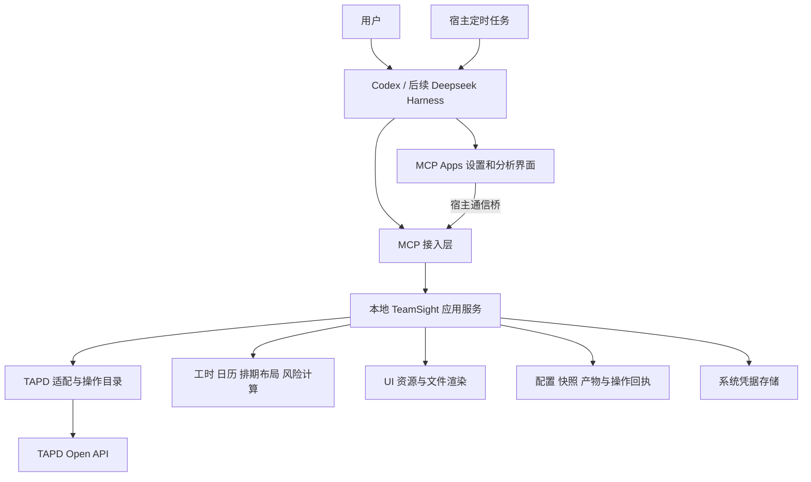

# TeamSight 本地服务、MCP 与 MCP Apps 技术方案

## Summary

版本：v1.0；日期：2026-10-27；状态：基于已确认产品取舍编制，待技术方案确认后实施。

将现有 TeamSight 从 Tauri 桌面应用演进为本地服务：Agent 通过 MCP 调用 TAPD 操作与团队分析能力，MCP Apps 承载会话内配置、甘特图、工时表和报表。宿主负责自然语言理解、工具编排与定时任务，TeamSight 负责数据、业务规则、输出和执行回执。

### 已确认范围

| 范围 | 首版交付 |
| --- | --- |
| 会话内配置 | 首次使用引导、主动打开设置、读取与提交配置、连接诊断 |
| TAPD 基础操作 | 需求与任务的搜索、读取、创建、修改；项目、成员及字段元数据 |
| 团队分析 | 排期聚合、每日工时、当前排期与区间工时报告、按需风险检查 |
| 呈现与导出 | MCP Apps、JSON、PNG/SVG、HTML、Markdown/CSV；Agent 可据结构化数据生成 UI |
| 定时使用 | 复用宿主定时任务，调用相同查询、分析和报告能力 |
| 首发组合 | Codex + macOS/Windows；Deepseek Harness 随后适配，Linux 后续支持 |
| 旧 App | 过渡期保留对照，新形态达到验收后退役 |

紧急插队的任务拆解、资源分配、方案模拟与批量重排属于后续使用场景。首版保留普通任务创建和字段修改能力，不为该场景提前建设优化器、草案系统、技能库或批量审批界面。

首个实施门槛是验证目标 Codex 版本的 MCP Apps 配置往返与资源展示。已确认 MCP 工具接入，不等于已验证 Apps UI；本方案不将尚未验证的宿主能力描述为现有功能。

## Implementation Plan

### 1. 总体架构与技术选择

采用 TypeScript 领域核心、Node.js 本地服务、Vue MCP Apps UI，使用官方 MCP TypeScript SDK 与 MCP Apps SDK。沿用 pnpm，运行时采用经 macOS/Windows 验证的受支持 Node LTS；SDK、运行时和渲染依赖在 P0 锁定具体版本。



服务内共用一套用例、取数、缓存和权限校验。MCP、Apps 的工具调用和文件输出不各自复制业务规则。

建议逐步提取为以下模块，目录名称是目标结构：

| 模块 | 职责 | 边界 |
| --- | --- | --- |
| `packages/core` | 类型、日期/日历、工时计算、甘特布局、风险规则 | 不依赖 Vue、DOM、Tauri 或 MCP |
| `packages/tapd` | 元数据、操作目录、请求队列、分页、映射、读写错误 | 通过注入的传输与凭据接口访问 TAPD |
| `apps/server` | 用例、MCP、配置、存储、任务和资源管理 | 持有本地业务状态、访问范围和执行回执 |
| `apps/mcp-ui` | 设置、甘特图、工时表和报告视图 | 作为 MCP UI 资源随包交付，经宿主调用工具 |

静态渲染与命令行启动入口位于 `apps/server` 内部，分别消费分析视图模型和服务用例。输入契约使用同一份定义生成 MCP Schema 与服务校验规则。

首版不引入独立设置网站、模型服务或业务定时器。HTTP 仅按本地通信与 MCP 接入需要提供，不建设 Web 产品路由。

### 2. 现有能力如何迁移

迁移基线是当前工作区行为，包含现有按小时请假和中国日历逻辑。先提取纯函数，并让旧 App 转向同一份实现，再切换运行入口。

| 当前入口 | 迁移处理 |
| --- | --- |
| [TAPD client](/Users/haolin/Projects/team-sight/src/services/tapd/client.ts) | 保留聚合与映射；替换默认 Tauri 传输，新增服务端写入链 |
| [工时取数](/Users/haolin/Projects/team-sight/src/services/tapd/hours.ts) | 保留每日实际与累计花费独立查询；统一队列和完整性说明 |
| [工时统计](/Users/haolin/Projects/team-sight/src/hours/statistics.ts) | 提取为服务可执行的纯计算模块 |
| [工时与请假设置](/Users/haolin/Projects/team-sight/src/hours/settings.ts) | 保留 `max(每日规定工时 − 请假小时, 0)` |
| [中国日历](/Users/haolin/Projects/team-sight/src/calendar/chinaCalendar.ts) | 保留规则与年度缓存语义；下载与存储迁至服务 |
| [甘特布局](/Users/haolin/Projects/team-sight/src/gantt/layout.ts) | 服务与 UI 共用布局；补 SVG 序列化与 PNG 输出 |
| [甘特界面](/Users/haolin/Projects/team-sight/src/components/gantt/GanttBoard.vue) | 复用显示和交互，去除 Tauri 数据依赖 |
| [现有设置页](/Users/haolin/Projects/team-sight/src/pages/SettingsPage.vue) | 复用合适的表单组件，读写改走 MCP Apps 通信桥 |
| [设置存储](/Users/haolin/Projects/team-sight/src/services/settings.ts)与[凭据服务](/Users/haolin/Projects/team-sight/src/services/credentials.ts) | 配置统一进入本地服务；开发用 localStorage 不承担生产凭据存储 |

保留成员顺序、项目别名、部分数据提示和原始来源时间。业务日期显式传递，默认 `Asia/Shanghai`，避免服务所在时区改变统计结果。

### 3. 安装、连接与本地服务生命周期

目标体验是注册 MCP 后，由宿主启动入口并准备好本地服务，随后即可进入配置。

优先验证 `teamsight mcp` 启动入口：宿主通过 STDIO 启动轻量接入进程，入口发现或启动当前系统用户的单实例服务。服务可同时提供 Streamable HTTP；需要直接 HTTP 连接的客户端使用实际服务地址与访问凭据。

这是一套后端的两种接入方式。STDIO 入口必须保留工具 Schema、Apps 元信息、资源读取、错误及取消等语义；不能只代理工具文本结果。P0 同时验证宿主与 SDK 支持的接入方式，之后确定首发推荐配置。

建议提供以下命令，名称为目标接口，当前尚未实现：

```text
teamsight mcp
teamsight serve
teamsight status
teamsight doctor
teamsight stop
```

- 无 TAPD 凭据时也能启动，提供状态、设置与连接诊断。
- 发现文件与单实例锁位于当前用户数据目录；核对实例身份和健康状态，避免仅按 PID 判断。
- HTTP 默认监听 loopback，验证访问身份、Host 和来源；本地 MCP 凭据与 TAPD 令牌分离。
- 服务端口、实例信息和启动结果可诊断；端口冲突不能结束未知进程。
- MCP 协议使用 stdout 时，运行日志进入 stderr 或文件，防止破坏通信。
- 单个对话断开不直接结束其他连接使用的服务。显式停止或升级时先处理在途操作，记录未完成状态。

首发发行物应包含可用运行时或提供经过验证的安装依赖流程；最终用户不应临时编译原生依赖。SQLite、凭据管理和 PNG 渲染的发行物兼容性均属于 macOS/Windows P0 验证范围。

### 4. MCP Apps 设置闭环

MCP 工具声明 UI 资源关联，服务提供 `ui://` 资源，由宿主加载前端并建立通信桥。UI 资源与必要脚本、样式随包构建，不依赖运行时公网 CDN。

```text
首次使用 TeamSight / 用户主动打开设置
  → 获取服务与配置状态
  → 调用关联设置 UI 的工具
  → 宿主加载设置资源
  → UI 读取配置及修订号
  → 用户编辑并提交
  → MCP 工具校验与保存
  → 返回新修订号和脱敏连接状态
```

首次业务调用缺少配置时，返回 `CONFIG_REQUIRED` 及打开设置的下一步，不返回空团队或无风险结果。服务说明指导 Agent 打开设置；不承诺在与 TeamSight 无关的新对话中自动弹窗。

首版设置包括 TAPD 连接、项目范围与别名、成员身份与顺序、每日目标、按小时请假、结束状态、业务时区、中国日历和操作范围。技能配置属于后续排期场景，不提前进入首版表单。

配置保存采用“补丁 + 期望修订号”。服务完成校验与持久化后才返回成功；旧卡片提交产生冲突时，返回当前修订及可恢复信息。UI 临时状态与核心配置分离，不以 iframe localStorage 为持久化来源。

凭据写入优先使用系统凭据管理，读取工具只返回存在状态和掩码。UI 经宿主提交秘密可能涉及宿主日志或模型可见参数，P0 必须核对真实链路；不能仅凭 UI 工具的可见性声明就认定已完成保密。若目标宿主存在缺口，按已确认方向讨论适配或本机凭据注入，不默认恢复独立浏览器设置页。

### 5. MCP 工具与 TAPD 操作目录

对 Agent 提供少量稳定业务工具，再通过目录发现更多 TAPD 操作。以下名称为建议契约，实施时结合 SDK 约束固定。

| 组别 | 入口 | 主要职责 |
| --- | --- | --- |
| 服务与设置 | `teamsight_status`、`teamsight_open_settings`、配置读写与连接测试 | 引导配置、修订管理、脱敏诊断 |
| 常用 TAPD | `tapd_search_items`、`tapd_get_item`、`tapd_create_item`、`tapd_update_item` | 按 `entityType=story/task` 校验不同参数 |
| 元数据 | `tapd_list_workspaces`、`tapd_get_workspace_schema` | 项目、成员、字段、状态和值域 |
| 操作发现 | `tapd_list_operations`、`tapd_describe_operation`、`tapd_call_operation` | 调用已登记且有权限的接口 |
| 分析 | `teamsight_get_schedule`、`teamsight_analyze_hours`、`teamsight_check_risks` | 获取快照与可解释计算结果 |
| 交付 | `teamsight_render_gantt`、`teamsight_generate_report`、产物读取 | Apps 与文件输出 |
| 耗时作业 | 必要时提供作业查询与取消 | 多项目取数、大图生成等长操作 |

设置 UI 所需工具可按宿主能力限制展示范围，但工具隐藏或 Apps 元信息不能代替授权。普通工具与 UI 调用经过相同服务校验。

操作目录记录固定方法/路径、编码、Schema、分页、响应映射、读写类别、文档依据和支持状态。常用工具也走该目录，通用调用不接受任意 URL 或凭据头。

首批覆盖需求/任务基础读写及分析所需的任务、缺陷、工时查询。其余 TAPD 操作逐项扩展并公布覆盖状态；TAPD 页面有功能不代表开放接口可用。

关键契约：TAPD ID 使用字符串；字段与状态来自项目元数据；身份有歧义时返回候选；HTTP 状态与 TAPD 业务状态分别保存；创建/更新使用实际接口定义，不推导 REST 方法。当前读取成功不证明具备写权限，P1 要在指定测试项目验证需求与任务写入。

### 6. 分析上下文、快照与计算口径

所有复合能力使用显式上下文：项目、成员、时间范围、分析日、时区、配置修订、日历版本及刷新策略。默认范围与实际授权范围分别处理。

建议区分以下标识：

| 标识 | 含义 |
| --- | --- |
| `snapshotId` | 具有来源时间和覆盖说明的原始数据集合 |
| `analysisId` | 指定快照在确定规则与配置下的计算结果 |
| `artifactId` | 某次分析生成的 Apps 视图或文件产物 |
| `operationId` | 创建、修改等操作的持久执行回执 |

图、表、报告和风险引用同一分析上下文。查询时可直接组合分析与展示，后续工具通过 `analysisId` 继续生成结果；覆盖不足时明确补取或创建新分析，不能静默混用不同时间的数据。

每个结果至少带数据状态 `complete/partial/failed`、来源获取时间、覆盖范围、缺失原因、截断信息、工时单位与规则版本。缺数不能补零，缓存命中不能更新原始获取时间。

首版沿用现有 task/bug 工时口径。需求提供基础操作能力，不直接与子任务重复汇总。已填报实际、累计花费、未来预计和未知量分别表达；工时不被解释为个人绩效。

风险规则先覆盖已结束日的工时不足、覆盖明确的缺排期/缺预估、未结束工作项逾期和已有模型可解释的未来排期不足。当前未结束日只报告进度；未覆盖无负责人对象时不声称已完成无负责人扫描。容量超载与交付可行性留待约束模型完善，不因时间重叠直接下结论。

固定报告包含区间工时、目标与差额、当前排期、风险和数据限制。无历史快照时不生成历史排期变化或期间完成量结论。

### 7. 图表、Apps 与文件交付

Apps UI 消费结构化视图模型，支持时间范围筛选、成员查看、明细展开及风险追溯。UI 操作通过 MCP 获取结果，不直连 TAPD。

甘特图复用现有布局生成 SVG，再栅格化为 PNG；UI 与静态渲染共用布局口径。中文字体、长标题、多人分组、大画布与分图在两个首发系统验证。HTML 由受信模板与转义数据生成，外部描述不能直接进入可执行脚本。

工时表返回完整结构化数据、适量对话摘要与 CSV，可按需生成图片和 HTML。报告输出 Markdown/HTML 与事实 JSON。PDF、XLSX 和模板编辑器不作为首版依赖。

工具返回摘要、结构化结果、产物元信息，并按需要返回图片或 MCP 资源。产物含 MIME、大小、来源分析与资源引用，不要求 Agent 只凭本机绝对路径读取文件。导出的 HTML 是否能在会话执行，按宿主验收结果说明。

Agent 生成式 UI 可以调整视图组织，但指标与证据使用服务结果。Apps 不可用的第二宿主仍可使用 JSON、文字和图片；配置入口的适配策略单独说明，不默认为其增加网站。

### 8. 创建、修改与不确定结果

普通需求/任务创建与修改在用户已授权的项目和操作范围内执行。首版不增加插队专用批量执行流程。

服务执行前校验元数据、对象身份与允许修改字段。更新可比较读取时的修改标记或字段摘要；TAPD 未提供原子条件更新时，只能降低冲突风险，不能保证消除竞态。

写入使用稳定幂等键并持久记录操作、参数摘要、发起主体、状态和远端对象标识。同一键配不同参数拒绝执行。该机制减少本服务内重复请求，不提供跨 TAPD 的恰好一次保证。

请求发出后遇到超时、断连或重启，可能进入 `unknown`。先核实远端结果，再决定是否重试；不能沿用读取自动重试。成功后读取核对并失效相关缓存，原快照报告保持原样。

日志与回执保留诊断所需信息，令牌和敏感正文不写日志。删除、权限变更和未登记操作不通过通用入口绕过策略。后续批量重排若需要审批，应绑定具体变更集，而非接受 Agent 自填确认标志。

### 9. 存储、缓存与并发

SQLite 保存配置及修订、快照/分析/产物元信息和操作回执；较大快照与渲染产物保存在当前用户数据目录。TAPD 凭据独立存入系统凭据管理，不随配置导出。

完整查询缓存保留原始获取时间；不完整数据可供本次分析说明，但不提升为完整缓存。缓存身份包含凭据主体/版本、授权范围和查询条件；规则变更复用适用原始快照重算，展示别名变化不触发不必要取数。

全服务共用 TAPD 请求队列，先沿用当前并发 3 并量测。读取采用有上限的退避重试；分页预算、重复分页检测、取消和截断结果均显式处理。逐个未完成工作项读取累计花费的成本仍需量测，服务化不会自动消除。

短查询直接返回，长计算在达到响应预算时转为可查询作业；不依赖宿主必须实现某个任务扩展。重启后计算作业标记中断，在途写入按未知状态核实。数据清理不得删除未完成或待核实的操作回执。

### 10. 宿主定时任务

TeamSight 提供确定性查询与报告接口，以及日常检查、每周报告的参数和使用模板。用户通过宿主创建定时任务，宿主到点运行 Agent 并调用 MCP。

只有宿主真实创建任务并返回任务标识后，才能展示已安排执行。TeamSight 不保存一份 cron 就宣称宿主已创建任务，也不在首版自带业务定时器。

首批周期场景以读取、风险检查和报告为主。绑定明确业务时区；中国工作日可采用每日触发后按业务日历过滤。电脑或应用关闭、服务离线、凭据失效时的表现和补跑能力，依据目标宿主实测说明。

验收要验证定时执行环境可访问同一服务、数据目录和凭据，且工具权限允许无人值守调用。宿主通知由宿主负责；TeamSight 返回结果与回执，不额外引入消息渠道。

### 11. 旧配置迁移与旧 App 退役

1. 以当前有效配置为输入，保留项目、成员顺序、别名、目标工时、小时请假与日历缓存。
2. 导入前备份源文件，校验后在新服务事务中保存；不改写源配置。凭据导入时转入新的凭据存储，不回显原值。
3. 两种形态使用各自数据目录，过渡期不并发写同一个配置文件；核心计算尽量共用，以同一输入做结果对照。
4. Codex 在 macOS/Windows 的首版功能、迁移、图表及宿主定时调用达到验收后，退役旧桌面入口，停止双轨维护。
5. 退役时移除 Tauri 专属运行依赖，保留已迁移的业务模块、测试和必要配置备份；不以 Deepseek Harness、Linux 或插队场景完成作为退役前提。

### 12. 实施阶段与交付门槛

| 阶段 | 内容 | 进入下一阶段的条件 |
| --- | --- | --- |
| P0：宿主与运行验证 | Codex Apps 设置往返、工具/资源展示、服务启动、凭据链路、跨平台依赖、最小定时调用 | 有实测的 SDK/协议/宿主版本组合；配置路径成立；macOS/Windows 的关键发布依赖可用 |
| P1a：核心与配置 | 提取核心、服务传输、统一存储、配置导入、Apps 设置、基础查询 | 不依赖 Tauri 可计算；新旧输入口径一致；配置保存与恢复可靠 |
| P1b：首版能力 | 需求/任务写入、复合分析、风险、Apps 图表、静态输出、固定报告 | Codex 完整场景通过，写入与数据不完整情况可解释 |
| P1c：首版发布与退役 | 两系统安装、迁移、宿主定时工作流、使用诊断、旧 App 对照验收 | 首版验收通过后退役旧 App |
| P2：第二宿主 | Deepseek Harness 的实际版本适配 | 分别记录工具、Apps、产物、认证与定时能力边界 |
| 后续 | Linux、更多 TAPD 对象，以及按新需求启动的插队协作 | 各自形成独立范围与验收，不提前增加首版依赖 |

P0 出现宿主 UI 缺口时，先形成可复查结果并收敛适配方案，再继续依赖该能力的实现；不把未验证假设留到发布末期。未经原型与范围量测，不承诺固定工期。

## Test Plan

本轮编制技术方案，尚未实施或运行功能测试。未来验证采用以下场景，并迁移现有有效测试；新增测试覆盖新的契约和失败边界。

| 对象 | 验证内容 |
| --- | --- |
| 核心计算 | 同快照的新旧结果、小时请假、节假日/调休、跨月跨年、时区、成员顺序、累计花费和未知量 |
| 配置与凭据 | 无配置启动、Apps 读取/保存、两会话修订冲突、磁盘失败、凭据链路、导入不丢数据 |
| TAPD 读写 | 真实字段与权限、字符串长 ID、分页与限流、业务错误、重复提交、超时未知、并发修改及读回 |
| 呈现 | 图表与报告同口径，中文字体、大范围拆图、转义、CSV 公式注入处理及资源读取 |
| 生命周期 | 多客户端单实例、断连、端口冲突、启动失败、取消、退出、重启恢复和日志脱敏 |
| 定时执行 | 宿主真实调度、同一 MCP 可达、无人值守权限、工作日/时区、休眠离线及失败回执 |
| 首发发行物 | macOS/Windows 安装、运行时与原生依赖、路径空格、权限、凭据和资源打包 |

首版验收以 Codex 完成“安装配置 → 基础读写 → 排期/工时分析 → Apps 与文件结果 → 周期调用”为闭环，并完成旧 App 关键语义对照。P0 宿主验证与真实 TAPD 写入验收不能由单元测试代替。

## Assumptions

- 产品范围依据已确认的[头脑风暴讨论稿 v0.4](/Users/haolin/Projects/team-sight/artifacts/plan/20261027_2316_teamsight-brainstorm-mcp-apps.md)。产品方向确认不等同于技术方案已批准实施。
- 首版面向单个本机用户与多个本机可达 Agent 客户端；团队共享服务和云端访问另行设计。
- Codex Apps、无人值守 MCP、目标 Deepseek Harness 版本及发行依赖仍需真实验证；不由文档推导为已兼容。
- 凭据、TAPD 写权限和工时单位按实际项目校验。未实际创建或修改远端对象，不将文档存在视为权限证明。
- 首版不实现插队优化与批量重排；未来可使用显式技能、容量预留、Agent 提案及服务评估，按具体方案授权应用。

### 参考依据

- [MCP Apps](https://modelcontextprotocol.io/docs/extensions/apps)与[SDK](https://apps.extensions.modelcontextprotocol.io/api/)：资源、宿主通信与工具交互。
- [Codex MCP](https://learn.chatgpt.com/docs/extend/mcp)与[定时任务](https://learn.chatgpt.com/docs/automations)：接入方式与本地执行条件。
- [OpenAI ChatGPT UI 文档](https://developers.openai.com/plugins/build/chatgpt-ui)：UI 资源与状态实践，Codex 行为单独验证。
- [TAPD API 文档](https://open.tapd.cn/document/api-doc/API%E6%96%87%E6%A1%A3/api_reference/)：登记操作与字段契约的来源，具体项目权限需验收。
- 当前工作区源码、项目知识，以及[上一轮服务技术讨论](/Users/haolin/Projects/team-sight/artifacts/plan/20261027_2228_teamsight-local-service-mcp.md)。
